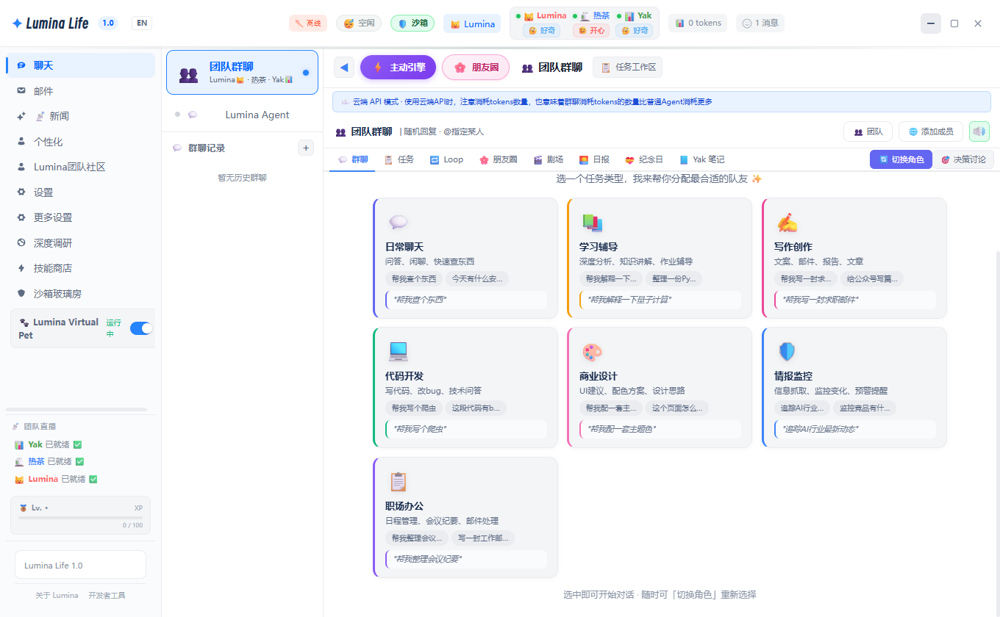
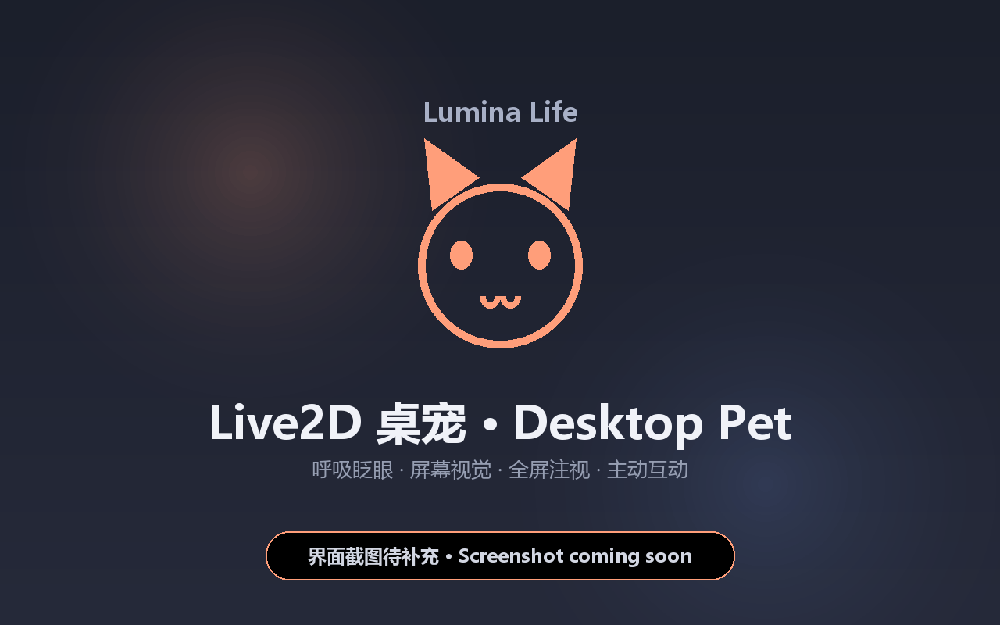
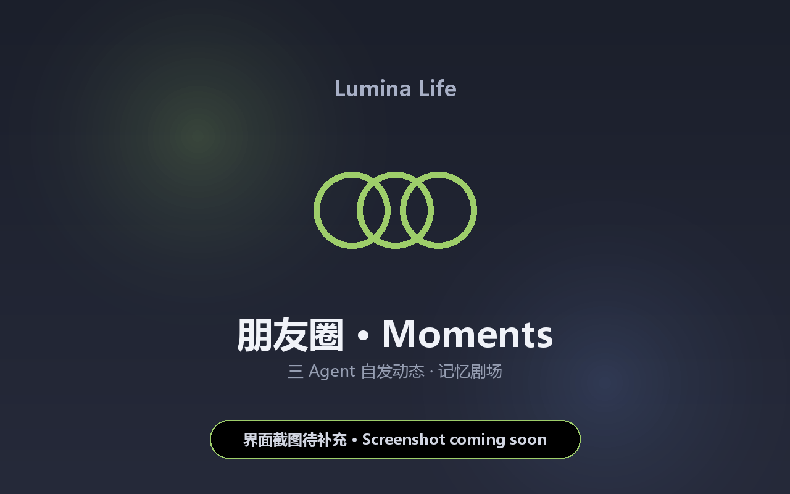

<p align="center">
  
  
  
  
  
  
</p>

<h1 align="center">
  🌸 Lumina Life
</h1>

<p align="center">
  <b>你的桌面不再孤单。</b><br>
  <i>Your desktop just got a soul.</i>
</p>

<p align="center">
  <b>三个 AI 住在你的电脑里——有情绪、会说话、真的帮你做事。</b><br>
  <i>Three AI agents live on your desktop — they feel, they talk, and they actually do things for you.</i>
</p>

<br>

<p align="center">
  <a href="#-quick-start"><b>🚀 快速开始</b></a> ·
  <a href="#-features"><b>✨ 核心亮点</b></a> ·
  <a href="#-why-lumina"><b>💡 为什么选 Lumina</b></a> ·
  <a href="#-architecture"><b>🏗️ 架构</b></a> ·
  <a href="#-screenshots"><b>📸 截图</b></a> ·
  <a href="#-roadmap"><b>🗺️ 路线图</b></a>
</p>

---

## 🎬 她跟别的 AI 不一样

<blockquote>
  <i>"Most AI tools wait for you to ask.<br>
  <b>Lumina notices when you need help.</b>"</i>
</blockquote>

&nbsp;&nbsp;🧠 **她的身体由大模型实时「驱动」，而不是播放预设动画：**<br>
&nbsp;&nbsp;&nbsp;&nbsp;每一次思考都会同时产出动作、表情和台词（结构化 `{action, mood, speech}`），上一句还在笑、被你怼了会先顿一下再小声回话——情绪有连续余韵。<br>
&nbsp;&nbsp;&nbsp;&nbsp;<sub>Each thought emits action + mood + speech together: the body is driven by the model in real time, not a scripted loop.</sub>

&nbsp;&nbsp;❄️ **她会在你对着屏幕发呆时，主动说：**<br>
&nbsp;&nbsp;&nbsp;&nbsp;*"累了吗？要不要休息一下？"*<br>
&nbsp;&nbsp;&nbsp;&nbsp;<sub>She notices when you're zoning out and checks on you.</sub>

&nbsp;&nbsp;👥 **她不是一个人——她身后还有两个队友：**<br>
&nbsp;&nbsp;&nbsp;&nbsp;Yak 码代码、热茶做审查，你只跟 Lumina 聊天就好。<br>
&nbsp;&nbsp;&nbsp;&nbsp;<sub>Yak codes, Recha reviews code — you only talk to Lumina.</sub>

&nbsp;&nbsp;🖥️ **她不只"告诉你"，她真的会帮你操作电脑：**<br>
&nbsp;&nbsp;&nbsp;&nbsp;截图→理解屏幕→自己移动鼠标。你说"帮我保存这个文件"她就照做。<br>
&nbsp;&nbsp;&nbsp;&nbsp;<sub>Screenshots → understands → moves your mouse. She actually does it.</sub>

&nbsp;&nbsp;💬 **她在你看不见的地方有「朋友圈」：**<br>
&nbsp;&nbsp;&nbsp;&nbsp;Lumina、热茶、Yak 会在后台群聊、互道早安、发朋友圈。<br>
&nbsp;&nbsp;&nbsp;&nbsp;<sub>Lumina, Recha, and Yak have group chats, morning greetings, and Moments — you just don't see it all.</sub>

---

## ✨ Core Features · 核心亮点

### 🧠 Multi-Agent Team · 三 Agent 团队协作

不是"一个 AI 做所有事"，而是三个各有所长的 Agent 组成团队，各司其职、流水线作业。

| Agent | 角色 Role | 性格 Personality | 专长 Expertise |
|-------|-----------|-----------------|---------------|
| **Lumina** 🐱 | 团队老大 — 唯一对用户接口<br>Team leader, your only interface | 温暖可爱、偶尔迷糊<br>Warm, caring, sometimes adorably clumsy | 对话 · 情绪感知 · 日常陪伴<br>Chat, emotion sensing, companionship |
| **热茶 (Recha)** 🍵 | 毒舌技术宅 — 后台工作者<br>Sarcastic engineer, behind-the-scenes | 外冷内热、毒舌但可靠<br>Cold on the outside, sharp but reliable | 写代码 · 调试 · 代码审查<br>Coding, debugging, code review |
| **Yak** 📊 | 冷静分析师 — 后台工作者<br>Calm analyst, behind-the-scenes | 理性至上、数据狂<br>Data-driven, logic-first | 搜索 · 分析 · 任务调度<br>Research, analysis, task orchestration |

**如何协作？** How they work together:

```
你 "帮我查一下这个bug怎么修"
  │
  ▼
Lumina 🐱 判断 → "这个让 Yak 看看"
  │
  ├── delegate → Yak 📊 写修复方案
  │                  │
  │                  └── delegate → 热茶 🍵 审查代码
  │                                    │
  └── Lumina 收到结果 → 整理→回复你
```

> 他们会在后台互相吐槽、讨论方案，但你看到的始终是一个统一、连贯的 Lumina。<br>
> <sub>They chat, debate, and banter behind the scenes — you always see one unified Lumina.</sub>

✅ 支持 `delegate_chain` 流水线：写代码 → 自动审查 → 自动修复<br>
✅ 每个 Agent 可独立配置 LLM（未配置则降级到 Lumina 的模型）

---

### 😊 Real Emotion System · 真实情感系统

不是表情包，不是冷冰冰的状态栏——**她真的有情绪。**

| 维度 | 说明 |
|------|------|
| **五维 + 三维情绪** | 团队侧五维：🥰开心 · 😴疲劳 · 🎯专注 · 😰焦虑 · 🤔好奇；底层用心情 / 精力 / 亲密度三个连续数值，带惯性、漂移与昼夜节律<br>Five team-level dimensions over a mood/energy/affinity numeric core with inertia, drift and circadian rhythm |
| **实时可视化** | Lumina 的表情和语气随情绪实时变化<br>Her expression and tone shift in real time |
| **关系记忆** | Agent 之间的亲密度/信任/协作数随**真实委托与群聊事件**演化，并持久化到本地（重启后保留）<br>Inter-agent affinity/trust evolve from real delegation & group-chat events and persist locally |
| **主动搭话** | 不是冷通知——"主人你对着屏幕发呆好久了，要休息一下吗？"<br>Not a cold notification — "You've been staring at the screen for a while. Take a break?" |
| **桌宠双渲染** 🖼️ | 主线 Live2D；VRM 为 beta——五维情绪已接入 VRM（情绪数值 → blendShape），但口型 / 视线跟随暂仍在 Live2D，VRM 情绪动作默认关（`pet.vrmExpressive`） |

---

### 📚 Real Memory · 真正的记忆

不是"聊完就忘"的上下文窗口——**她真的记得你。**

| 能力 | 说明 |
|------|------|
| **短期记忆** | 当前对话上下文，支持自动压缩 |
| **长期记忆** | SQLite 持久化 + 结构化事实/反思/人格 |
| **混合召回** | BM25 词法检索（CJK 友好，已实现）；向量语义召回在 Roadmap 中（需配置本地 Ollama / Python embedding）<br>Hybrid recall: BM25 lexical recall (implemented); semantic embeddings on roadmap |
| **自动精炼** | 定时清理低质量记忆，保留真正重要的 |
| **证据链** | 每条记忆有置信度评分，不是瞎猜 |
| **记忆剧场** | 可视化浏览你和 Lumina 的回忆 |

> <sub>Memory is the soul of companionship. Lumina remembers. That's what makes her different.</sub>

---

### 🖥️ Computer Use · 真正的桌面操控

不只是"告诉你该怎么做"——**她真的会操作你的电脑。**

```
你: "帮我把这个文件拖到桌面上"
                │
                ▼
  ① 截图当前屏幕
  ② VLM 分析画面内容
  ③ 定位文件 + 桌面位置
  ④ 移动鼠标 → 拖拽 → 完成 ✅
```

💡 **屏幕感知**：你在写代码？热茶会自发提出优化建议<br>
💡 **看得见你的操作**：不只是聊天窗口，是整个屏幕

---

### 🛡️ Smart Sandbox · 智能沙箱

不用害怕 AI 会乱动你的电脑 — **Lumina 的沙箱模式让她做任何敏感操作前都会先问你。**

| 等级 | 说明 |
|------|------|
| **双层安全审查** | ① 消息/参数级：securityGuard 6 级×10 类，审查 LLM 输入和工具参数；② 命令级：sandboxRules 7 级×8 类 26 条规则，审查即将执行的 shell 命令（含 BLOCK 级硬拦截：格式化/rm -rf 根/fork 炸弹/删系统目录） |
| **🔍 沙箱玻璃房** | 侧栏「沙箱玻璃房」面板实时显示每条命令命中的级别 / 威胁类别 / 处置（放行 · 降级 · 拦截 · 审批），安全过程对你透明 |
| **审批流** | 危险操作先弹窗问你，你点头她才做 |
| **密钥拦截** | Token/Key 自动检测，阻止外泄 |
| **🆕 沙箱模式** | 一键开启 → 中高风险操作全部需确认；关闭 → 仅拦截严重风险 |

> <sub>She's powerful, but she always asks first.</sub>

---

### 💬 Team Social Life · 团队社交生活

Agent 之间不是机械的任务分配——**他们有真实的"社交"。**

| 功能 | 说明 |
|------|------|
| **群聊** 💬 | Lumina、热茶、Yak 在后台自发聊天（你可以旁观） |
| **早安仪式** 🌅 | 每天早上团队互道早安，同步日程 |
| **Moments 朋友圈** 📱 | Agent 记录自己的状态和想法，像真人朋友圈 |
| **关系演化** ❤️ | 委托成功 / 失败、群聊参与、建设性分歧会改变彼此的亲密度、信任与协作数并持久化（数值驱动，非剧情化"吵架和好"） |
| **亲密度影响审查语气** 🔊 | 热茶的代码审查语气随她与 Lumina 的亲密度变：亲密度高 → 先肯定再提建议；低 → 硬邦邦直接指出问题 |

---

### 🎭 4 种人格模式 · 4 Personality Modes

| 模式 | 风格 | 适合场景 |
|------|------|---------|
| **Lumina（默认）** 🐱 | 活泼可靠 Lively & reliable | 日常使用，全能型 |
| **工作助手** 💼 | 干练高效 Professional & efficient | 写代码、分析数据、项目管理 |
| **闲聊伙伴** ☕ | 温暖随和 Warm & casual | 放松聊天、情感陪伴 |
| **创意助手** 🎨 | 发散思维 Creative & divergent | 头脑风暴、写作、设计 |

切换人格时，Lumina 的语气、回复深度、工具使用倾向都会改变——她真的"变身"了。

---

### 🔧 25–60 Built-in Tools · 运行时按模式加载（另可经 MCP / 技能市场扩展）

<sub>口径：代码库共实现约 110 个工具名（含团队/语音/系统等后台工具）；用户可见的聊天/Agent 运行时按模式加载 25–60 个，另可经 MCP 协议动态扩展。</sub>

`搜索` · `浏览器` · `文件操作` · `代码审查` · `终端` · `截图` · `桌面控制` · `定时任务` · `天气` · `邮件` · `翻译` · `OCR` · `语音输入` · `TTS` · `通知` · `记忆管理` · `MCP` · `技能系统` · ……

通过内置技能商店安装、卸载、升级——就像装 App 一样简单。<br>
<sub>Install, uninstall, upgrade skills like apps from a store.</sub>

---

## 💡 Why Lumina? · 为什么选 Lumina

不是又一个 AI 聊天窗口。Lumina 是 **唯一一个同时具备这三样东西的开源项目**：

| 能力 | 市面上其他项目 | Lumina |
|------|-------------|--------|
| **🤖 多 Agent 协作** | ❌ 单 Agent / 纯工具编排 | ✅ **3 人团队，流水线作业** |
| **😊 情感系统** | ❌ 几乎没有 | ✅ **5 维情绪 + 可视化 + 亲密度** |
| **🖥️ Computer Use** | ❌ 只有闭源产品有 | ✅ **截图→理解→操作** |
| **💬 团队社交** | ❌ 没见过 | ✅ **群聊 + 朋友圈 + 早安仪式** |
| **📚 真实记忆** | ⚠️ 简单上下文 | ✅ **SQLite + BM25 词法召回（向量语义在 Roadmap）+ 证据链** |
| **🛡️ 智能沙箱** | ❌ 基本没有 | ✅ **双层安全审查 + 审批流** |
| **🔧 工具生态** | ⭐ 看项目 | ✅ **25–60 工具/技能 + MCP + 技能商店** |
| **🎭 人格切换** | ❌ 少见 | ✅ **4 种人格模式** |

> <sub>There are AI tools. There are AI companions. **There's nothing quite like Lumina.**</sub>

---

## 🚀 Quick Start · 快速开始

### 方式一：下载安装包（推荐）

> 首个公开版本（v0.1）即将发布；发布后可从 [Releases](https://github.com/lumina-life/lumina-life/releases) 下载安装包，双击安装、3 分钟上手。在此之前请用下方「开发者模式」运行。

### 方式二：开发者模式

```bash
# Prerequisites: Node.js 18+ · Python 3.10+（可选）
git clone https://github.com/lumina-life/lumina-life.git
cd lumina-life
npm install
cp .env.example .env            # 编辑 .env 填入 LLM API（默认 LM Studio 已激活）
npm run dev                     # 启动！
```

> 💡 **可选：安装 Python 依赖**（语音输入/输出、以及可选的语义向量召回需要；默认 BM25 无需 Python）
> ```bash
> pip install -r python/requirements.txt
> ```
> 如果只用文本聊天，可跳过此步骤。

### 连接 LLM

| 提供商 | baseUrl | 说明 |
|--------|---------|------|
| **LM Studio**（推荐） | `http://127.0.0.1:1234/v1` | 免费、隐私、离线 |
| **Ollama** | `http://127.0.0.1:11434/v1` | 免费、隐私、离线 |
| **DeepSeek** | `https://api.deepseek.com/v1` | 超低价、中文好 |
| **通义千问** | 阿里云百炼 | 国产强模型 |
| **硅基流动** | `https://api.siliconflow.cn/v1` | 多模型聚合 |
| **OpenAI** | `https://api.openai.com/v1` | GPT-4o 等 |

> 💡 在应用设置 → LLM 配置中填入即可。推荐使用 LM Studio 实现完全本地运行。

---

## 🖥️ 系统要求与平台支持

> **当前 v0.1.0-preview 仅支持 Windows 10/11 (x64)**。macOS 和 Linux 支持在 Roadmap 中（见下文）。

| 平台 | 状态 | 说明 |
|------|------|------|
| 🟢 **Windows 10/11 x64** | ✅ 当前唯一支持 | NSIS 安装包 / 便携版 |
| 🟡 **macOS** | 🔜 Roadmap (v1.3.0) | 代码有初步适配但未验证，CU/键鼠走 PowerShell 需重写 |
| 🟡 **Linux** | 🔜 Roadmap (v1.3.0) | 同上 |

> ⚠️ **为什么当前只有 Windows？**<br>Computer Use 的键鼠注入、沙箱规则库、托盘集成都深度依赖 Windows API（PowerShell、UIA、IL 降级）。macOS/Linux 支持需要重写这些模块，计划在 v1.3.0 完成。

---
---

## 🖥️ CLI & API

Lumina 提供完整的命令行工具和 REST API，无需启动 GUI 即可使用。

### 命令行

```bash
lumina doctor       # 系统诊断
lumina chat "你好"  # 直接对话
lumina tool list    # 列出工具
lumina agent status # 查看 Agent 状态
lumina memory search "上次聊的..." # 搜索记忆
```

> 💡 确保 `lumina.cmd` 所在目录已加入系统 PATH：
> ```cmd
> setx PATH "%PATH%;C:\Program Files\Lumina Life\resources"
> ```

### REST API

```bash
# 健康检查
curl http://localhost:3456/api/health

# 发送消息
curl -X POST http://localhost:3456/api/chat \
  -H "Content-Type: application/json" \
  -d '{"message":"你好","agent_id":"lumina"}'
```

支持 10+ 端点：聊天 · 工具执行 · Agent 管理 · 记忆检索 · 技能管理 · 配置读写 · 定时任务

---

## ⚖️ 设计哲学 · 铁则

> Lumina Life 的开发遵循几条「铁则」——它们是这个项目的灵魂和底线。理解它们，就理解了 Lumina 为什么是 Lumina。

### 🥇 铁则一：用户只看到 Lumina

用户全程只与 Lumina 🐱 对话。热茶 🍵 和 Yak 📊 在后台隐身工作，用户感知不到他们的存在。

```
用户：帮我算一下这个月的开支
Lumina：好的，我让数据分析师看看↗
        （内部 → Yak 处理数据）
Lumina：本月开支共 ¥3,280，比上月少 12% 哦！主要节省在餐饮上 👍
```

**为什么？** 真实用户不需要知道"系统里有几个 agent"。一个可信赖的助手就够了，后台分工是架构问题，不是用户问题。

### 🥈 铁则二：Lumina 有情绪，且情绪影响行为

Lumina 不是冷冰冰的 API 返回器。团队侧维护五维情绪（开心 / 疲劳 / 专注 / 焦虑 / 好奇），底层由心情、精力、亲密度三个连续数值驱动，并带惯性、随机漂移与昼夜节律；桌宠表情则由大模型每帧实时输出。她的回复风格、主动性、甚至记忆力都会受情绪影响。

| 情绪状态 | 效果 |
|---------|------|
| 😊 happy | 主动关心你、回复更活泼 |
| 😢 sad | 话变少、需要安慰 |
| 😠 angry | 语气冲、但会道歉 |
| 😐 neutral | 正常工作状态 |
| ❤️ 亲密度高 | 更有默契、愿意敞开心扉 |

### 🥉 铁则三：记忆是连续的，不是一次性的

Lumina 记得你。每次对话都是你们关系的延续，不是从头开始的 API 调用。

```
短期记忆（当前会话）→ 是否重要？→ 长期记忆（SQLite）
                                    → BM25 词法召回（默认，已实现）· 向量语义召回（Roadmap，未实现）
                                    → 摘要 → 每日记忆
```

每次回复时，Lumina 会自动检索相关记忆，让对话有「延续感」——她记得你上周说过想去日本看樱花，今天会主动问"签证办好了吗？"

### 🏅 铁则四：安全不是选项，是默认值

| 安全机制 | 说明 |
|---------|------|
| 🛡️ 沙箱模式 | 双层审查：消息/参数级（6×10）+ 命令级（7×8，26 条规则） |
| 📋 审批流 | 高风险操作需要用户手动确认 |
| 🔒 隐私优先 | 所有数据本地存储，不上传云端 |
| 🔑 API Key 隔离 | LLM Key 与应用权限分离 |
| 🚚 数据导出/导入 | 本机记忆一键打包为 zip（manifest + 人读 memory.md + 每表 JSON），导入时按主键去重、绝不覆盖现有数据 |
| 🎛️ 功能开关 | 设置页可逐项开关全部新能力（实验项默认关）；`mode.minimal` 精简模式只露「会主动找你 · 真记得你 · 安全帮你干一件事」 |

### 🏅 铁则五：开源是承诺，不是营销

Lumina Life 采用 **双许可证（AGPL-3.0 OR Apache-2.0）**。你可以永远自由地使用、修改、分发它，不必担心「开源陷阱」。[了解更多](#🔓-open-source--开源说明)

---

## 🏗️ Architecture · 架构一览

```
┌─────────────────────────────────────────────────────────────┐
│                     Electron Shell                            │
│  ┌─────────────────────────────────────────────────────────┐ │
│  │               Multi-Agent System                         │ │
│  │  ┌──────────┐  ┌──────────┐  ┌──────────┐               │ │
│  │  │  Lumina  │  │   热茶   │  │   Yak    │               │ │
│  │  │  🐱 BOSS  │  │  🍵 DEV  │  │  📊 ANAL  │               │ │
│  │  └────┬─────┘  └────┬─────┘  └────┬─────┘               │ │
│  │       └──────────────┼──────────────┘                     │ │
│  │              Team Social Engine                           │ │
│  │         (自发聊天 · 早安仪式 · 朋友圈)                     │ │
│  └──────────────────────┬──────────────────────────────────┘ │
│  ┌──────────────────────┼──────────────────────────────────┐ │
│  │     Tool Registry    │    Skill Ecosystem               │ │
│  │  25-60 tools/skills · MCP │  Plugin SDK · Skill Store      │ │
│  └──────────────────────┼──────────────────────────────────┘ │
│  ┌─────────────────────────────────────────────────────────┐ │
│  │  Memory · Security · Session · Approval · Cron          │ │
│  └─────────────────────────────────────────────────────────┘ │
└─────────────────────────────────────────────────────────────┘
```

### 项目结构

```
lumina-life/
├── electron/       # 主进程 — Agent 引擎 · 记忆 · 工具 · 安全
├── src/            # 渲染进程 — 23 个面板 · React 19 · Zustand
├── tests/          # 测试文件 — Vitest · 单元+集成+E2E
├── skills/         # 技能目录
├── knowledge/      # 知识库
└── dist/           # 安装包输出
```

---

## 📸 Screenshots · 截图

> Lumina 的界面充满活力和温度——这里是她在日常工作中的样子。

| 功能 | 预览 |
|------|------|
| 💬 **聊天面板**<br>与 Lumina 日常对话，支持流式输出、情绪显示 |  |
| 🐾 **Live2D 桌宠**<br>桌面上的 Lumina，呼吸/眨眼/表情随情绪变化 |  |
| 📱 **Moments 朋友圈**<br>旁观 Lumina、热茶、Yak 的自发动态 |  |

> ⚠️ **截图待补**：v0.1.0-preview 发布前请补充以下 3 张截图到 `docs/images/`：
> 1. `chat-panel.png` — 主聊天面板（含消息流 + 情绪指示）
> 2. `pet-live2d.png` — 桌面上的 Live2D 桌宠小窗口
> 3. `moments.png` — Moments 朋友圈面板
>
> 截取方式：启动 `npm run dev`，用 Windows 自带截图工具（Win+Shift+S）截取，保存为 PNG 放入 `docs/images/` 即可。
---

## 🧪 Tech Stack · 技术栈

| 层 Layer | 技术 Technology |
|----------|----------------|
| 桌面框架 Desktop Framework | **Electron 40** |
| 前端 Frontend | **React 19** + TypeScript + Vite |
| 状态管理 State Management | **Zustand 5** (persist) |
| 构建打包 Build | electron-vite + electron-builder (NSIS) |
| 数据库 Database | better-sqlite3 |
| 测试 Testing | Vitest |
| 自动更新 Auto Update | electron-updater (GitHub Releases) |
| 协议支持 Protocols | MCP (Model Context Protocol) |

---

## 🗺️ Roadmap · 路线图

- ✅ **当前开发版** — 三 Agent 团队 + 情感系统 + 记忆系统 + 25–60 工具/技能 + Computer Use + 🛡️ 智能沙箱（首个公开版本 v0.1 待发布）
- 🔜 **v1.1.0** — 自定义 Agent 创建（定义新角色加入团队）
- 🔜 **v1.2.0** — 插件生态开放（社区技能商店）
- 🔜 **v1.3.0** — macOS / Linux 支持
- 🔜 **v1.4.0** — 多模态增强（图片理解、视频理解）
- 🔜 **v1.5.0** — 移动端伴侣（iOS / Android 通知同步）

### 🧪 实验性 / 彩蛋功能（非主线，请勿当真）

- **梦境日记、Agent 真人秀**：已接 LLM 真实生成（在设置里配好 LLM 后即走真实模型）；未配置时回退到 **9 个情绪锚点模板 + 记忆片段关键词**，UI 用 `来源: llm / 来源: template` 诚实标注，绝不假装是大模型写的。
- **记忆检索**：当前为 BM25 词法召回（已实现）；向量语义召回在 Roadmap 中，需配置本地 Ollama / Python embedding 服务。
- **副人格觉醒（实验）**：最小真实机制已上线——基于长期记忆 + 情绪状态的人格漂移 / 副视角，触发条件为「高亲密度 + 累计约 200 轮对话」或「持续高焦虑」，置于 `personality.subPersona` 开关后**默认关闭**、可随时关；仍属实验性，不代表核心陪伴能力。

---

## 🔓 Open Source · 开源说明

Lumina Life 采用 **双许可证（Dual-License）** 发布，您可在以下两者中选择其一：

### 选项一：AGPL-3.0（社区版）

适合个人用户、开源项目和教育用途。

| ✅ 你可以 | 📋 需要遵守 |
|----------|------------|
| 自由使用、修改、分发 | 分发修改版时需公开源代码 |
| 创建自定义角色/人格 | 保留版权声明 |
| 开发新技能并分享 | 网络交互视为分发（AGPL-3.0 标准条款） |
| 提出 Issue 和 Feature Request | — |
| 免费用于个人用途 | — |

> **为什么保留 AGPL-3.0？** 我们希望 Lumina 的核心能永远开放，让社区可以自由定制和改进。选择 AGPL-3.0 的用户，您的改进也会回馈给整个社区。

### 选项二：Apache 2.0（商业版）

适合企业集成、商业产品嵌入和闭源部署。

| ✅ 你可以 | 📋 需要遵守 |
|----------|------------|
| 自由使用、修改、分发 | 保留版权声明 |
| 集成到商业闭源产品中 | 无"开源传染"要求 |
| 创建衍生作品（包括闭源） | 修改处需显著标注 |
| 用于商业目的 | — |

> **选择权在你手中。** 两个许可证都附在项目根目录中：
> - [`LICENSE`](LICENSE) — AGPL-3.0
> - [`LICENSE-APACHE`](LICENSE-APACHE) — Apache 2.0

---

## 💬 Community · 社区

| 途径 | 用途 |
|------|------|
| 💡 [GitHub Issues](https://github.com/lumina-life/lumina-life/issues) | Bug 反馈 & 功能建议 |
| 📖 [GitHub Discussions](https://github.com/lumina-life/lumina-life/discussions) | 技术讨论 & 使用技巧 |
| 🎨 [贡献指南](CONTRIBUTING.md) | 参与开发的完整指引 |
| 📝 [更新日志](CHANGELOG.md) | 版本发布记录 |

---

<p align="center">
  <br>
  <b>Made with ❤️ by the Lumina team. And by Lumina herself. 🐱</b><br>
  <sub>She helped write this README. No, really.</sub>
  <br><br>
  <sub>⭐ 如果 Lumina 给你带来了快乐，请给仓库一个 Star ⭐</sub>
  <br>
  <sub>If Lumina brought a smile to your face, give the repo a star ✨</sub>
</p>
